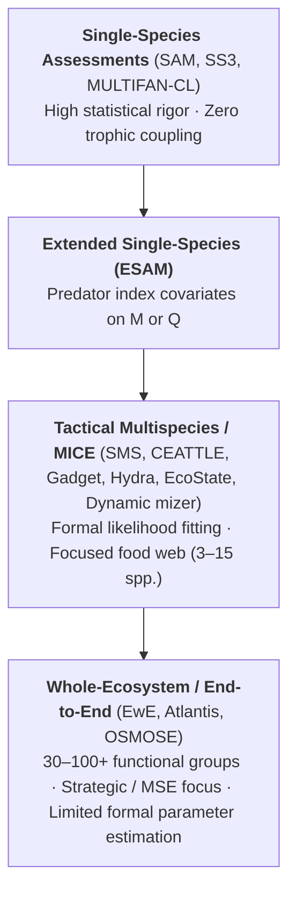
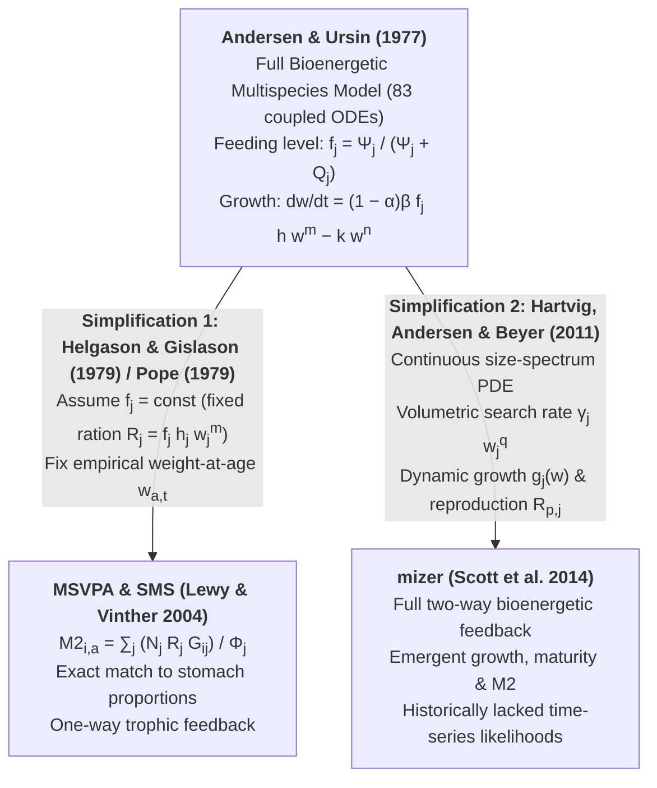

# Taxonomy and Theoretical Foundations of Multispecies Stock Assessment Models {#sec-taxonomy}

## The Complexity Spectrum: Strategic Models, Tactical Assessments, and MICE

Fisheries ecosystem models span a wide continuum of structural complexity, taxonomic resolution, and statistical rigor [@plaganyi2014; @collie2016; @karp2023]:

### Models of Intermediate Complexity for Ecosystem Assessments (MICE)
[@plaganyi2014] and [@collie2016] formalized the concept of **MICE** (Models of Intermediate Complexity for Ecosystem assessments) as the "sweet spot" for tactical fisheries management. As model complexity increases, **structural bias** (from omitting trophic interactions) decreases, whereas **parameter estimation uncertainty** (from fitting hundreds of poorly identified interaction rates to noisy data) increases rapidly [@collie2016, Fig. 1].

A model qualifies as a tactical multispecies assessment or MICE when it satisfies four operational criteria [@plaganyi2014; @karp2023]:
1. **Context-Driven Taxonomic Scope**: It models only the core interacting species (typically $3\text{--}12$ commercial predator and prey stocks plus $1\text{--}3$ aggregated "other food" or resource pools) responsible for the majority of predation mortality and fishery yield.
2. **Formal Statistical Estimation**: Parameters are estimated by maximizing a formal likelihood (or posterior density) against empirical time series of commercial catches, scientific survey indices, age/size compositions, and stomach contents, rather than relying purely on literature plug-in values or manual tuning.
3. **Diagnostic and Uncertainty Quantification**: It provides standard stock assessment diagnostics (residual patterns, retrospective Mohn's $\rho$, profile likelihoods, Hessian/Laplace standard errors, or MCMC/SMC credible intervals).
4. **Operational Cadence**: It can be updated on the 1–5 year assessment cycle used by management bodies (e.g., ICES Working Group on Multispecies Assessment Methods [WGSAM] key runs supplying time-varying $M = M1 + M2$ matrices to single-species SAM assessments, or NOAA NPFMC Bering Sea CEATTLE runs).

---

## Fundamental Axes of Structural Classification

Every multispecies stock assessment model can be positioned along three fundamental mathematical axes [@stefansson1998; @andersen2016; @pennino2025]:

### Axis 1: Individual State Space (Age vs. Length vs. Continuous Body Mass)

| State Space | State Variable | Representative Models |
| :--- | :--- | :--- |
| **1. Biomass Pool / Multi-Stanza** | $B_{i}(t)$ | `Ecopath with Ecosim` [@walters1997], `Rpath` [@lucey2020], `EcoState` [@thorson2024] |
| **2. Discrete Age-Structured** | $N_{i,a,t}$ | `MSVPA`/`MSFOR`, `SMS` [@lewy2004], `MSCAA`/`Hydra`, `CEATTLE` |
| **3. Joint Age-Length Structured** | $N_{i,a,l,t},\; W_{i,a,l,t}$ | `MULTSPEC`, `BORMICON`, `Gadget2`, `gadget3` [@stefansson1998; @begley2004overview] |
| **4. Discrete Length-Structured (Age-Free)** | $N_{i,l,t}$ | `LeMans` [@hall2006], `LeMaRns` [@spence2020], `CSMS` [@pope2006] |
| **5. Continuous Body-Mass Spectrum** | $N_i(w,t)$ ($\text{numbers}\cdot\text{g}^{-1}$) | `mizer` [@hartvig2011; @scott2014; @datta2010] |

1. **Biomass Pool / Multi-Stanza ($B_i(t)$)**:
   - *Governing Dynamical Equation*: Coupled system of ordinary differential equations (ODEs):
     $$\frac{dB_i}{dt} = g_i \sum_j Q_{ij} - \sum_k Q_{ki} - (M0_i + F_i) B_i$$ {#eq-biomass-pool-dynamics}
   - *Strengths & Limitations*: Fast; low state dimension; captures whole-food-web energy flow; cannot directly fit length or age compositions without multi-stanza delay-difference approximations.

2. **Discrete Age-Structured ($N_{i,a,t}$)**:
   - *Governing Dynamical Equation*: Difference equation along cohort diagonals with empirical weight-at-age $w_{i,a,t}$:
     $$N_{i,a+1,t+1} = N_{i,a,t} \exp(-Z_{i,a,t})$$ {#eq-age-cohort-dynamics}
   - *Strengths & Limitations*: Directly compatible with single-species age-based assessments; simple cohort tracking; requires aging data (otoliths); size-based predation must be mapped through fixed $w_{i,a,t}$ or age-length keys.

3. **Joint Age-Length Structured ($N_{i,a,l,t}$ and $W_{i,a,l,t}$)**:
   - *Governing Dynamical Equation*: Advection-dispersion across length bins within each discrete age class:
     $$\mathbf{N}_{i,a,t+\Delta t} = \mathbf{G}_{i,a,t} \mathbf{S}_{i,a,t} \mathbf{N}_{i,a,t}$$ {#eq-age-length-dynamics}
   - *Strengths & Limitations*: Separates chronological age from physical size; resolves size-selective mortality effects on mean length-at-age; computationally intensive due to the $(s \times a \times l \times r)$ state tensor.

4. **Discrete Length-Structured / Age-Free ($N_{i,l,t}$)**:
   - *Governing Dynamical Equation*: Matrix projection across length bins:
     $$\mathbf{N}_{i,t+1} = \mathbf{X}_i \mathbf{S}_{i,t} \mathbf{N}_{i,t} + \mathbf{R}_{i,t}$$ {#eq-length-matrix-dynamics}
   - *Strengths & Limitations*: Requires no otolith aging; matches survey length-frequency data directly; deterministic fractional bin transition ($\phi_{i,l}$) introduces numerical cohort diffusion unless a stochastic transition matrix $\mathbf{X}_{l,l'}$ is used.

5. **Continuous Body-Mass Spectrum ($N_i(w,t)$, $\text{numbers}\cdot\text{g}^{-1}$)**:
   - *Governing Dynamical Equation*: McKendrick–von Foerster PDE (or Fokker–Planck Jump-Growth PDE):
     $$\frac{\partial N_i}{\partial t} + \frac{\partial (g_i N_i)}{\partial w} = \frac{1}{2}\frac{\partial^2 (d_i N_i)}{\partial w^2} - \mu_i N_i$$ {#eq-pde-size-spectrum}
   - *Strengths & Limitations*: Mechanistic mass and energy conservation from plankton to top predators; emergent growth, maturity, and mortality; requires PDE discretization and diffusion treatment to track cohorts dynamically.

---

### Axis 2: Direction of Trophic Feedback (One-Way vs. Two-Way Coupling)

A critical distinction in multispecies stock assessment—emphasized by [@stefansson1998] and [@andersen2016]—is whether trophic interactions operate **one-way (top-down only)** or **two-way (top-down predation mortality + bottom-up bioenergetic growth/reproduction)**:

1. **One-Way Trophic Feedback ("Predation-Only" / Fixed-Ration Models)**:
   - Used in `MSVPA`, `SMS`, `LeMans`/`LeMaRns`, and standard modes of `MSCAA`/`Hydra`.
   - Predator abundance determines the predation mortality rate $M2$ experienced by prey:
     $$\text{Predator Abundance } N_{\text{pred}} \implies \text{Prey Mortality } M2_{\text{prey}}$$ {#eq-one-way-trophic-feedback}
   - However, **predator somatic growth rate, weight-at-age $w_{a,t}$, and per-capita total food consumption rate $R_{a,t}$ are independent of prey abundance**. Even if all modeled fish prey collapse, predators maintain their prescribed ration $R_{a,t}$ (implicitly compensating by consuming an inexhaustible "other food" pool $B_{\text{other}}$) and follow fixed growth curves.
   - *Consequence*: In forward projections under high forage-fish fishing mortality, one-way models predict that piscivores suffer **zero loss of growth or reproductive output** when their prey are fished down [@jacobsen2016; @pope2019].

2. **Two-Way Trophic Feedback ("Bioenergetic / Size-Spectrum" Models)**:
   - Used in `mizer`, `MULTSPEC`/`Gadget` (when configured with `g3a_grow_length_multspec` or `g3a_grow_weight_weightjones`), bioenergetic `CEATTLE`, and `Ecosim`/`EcoState`.
   - Every predation event simultaneously removes biomass from the prey cohort ($M2_{\text{prey}}$) **and** supplies assimilable energy to the predator cohort, driving somatic growth $g_{\text{pred}}$, energy reserves/condition $W_{\text{pred}}$, egg production $R_{p,\text{pred}}$, and (when energy intake falls below metabolic maintenance) starvation mortality $\mu_{s,\text{pred}}$:
     $$\text{Prey Abundance } N_{\text{prey}} \Longleftrightarrow \begin{cases} \text{Top-Down: Predation Mortality } M2_{\text{prey}} \\ \text{Bottom-Up: Predator Growth } g_{\text{pred}}, \text{ Reproduction } R_{p,\text{pred}}, \text{ Starvation } \mu_{s,\text{pred}} \end{cases}$$ {#eq-two-way-trophic-feedback}

---

### Axis 3: Calibration Paradigm (Deterministic VPA vs. Pattern-Oriented/History Matching vs. Integrated Statistical Likelihood)

1. **Deterministic / Iterative Backward VPA (`MSVPA`)**: Assumes catch-at-age and stomach contents are known without error; solves for historical $N_{a,t}$, $F_{a,t}$, and $M2_{a,t}$ via fixed-point iteration.
2. **Equilibrium / Pattern-Oriented / History Matching (`mizer` steady-state, `LeMaRns` SMC, `EwE`)**: Calibrates time-averaged catch or biomass against a steady-state reference period, or uses rejection/Sequential Monte Carlo sampling with implausibility metrics [@spence2021uncertainty] to identify ensembles of plausible parameter vectors.
3. **Integrated Maximum Likelihood / State-Space Assessment (`SMS`, `Gadget`/`gadget3`, `CEATTLE`, `MSCAA`/`Hydra`, `EcoState`)**: Formulates a differentiable forward process model coupled to explicit statistical observation models for each raw data stream (commercial catch-at-age/length, survey CPUE indices, stomach content proportions), optimizing the joint log-likelihood (or marginal Laplace likelihood in TMB) via automatic differentiation.

---

## The Andersen & Ursin (1977) Theoretical Foundation and Livingston's (1983) Evaluation

Virtually all modern size- and age-structured multispecies models—including **MSVPA**, **SMS**, **Gadget**, **LeMans/LeMaRns**, **CSMS**, and **`mizer`**—trace their mathematical lineage to the landmark monograph by K. P. Andersen and Erik Ursin [-@andersen_ursin1977], *"A Multispecies Extension to the Beverton and Holt Theory of Fishing, with Accounts of Phosphorus Circulation and Primary Production"*, Ursin's [-@ursin1973] empirical analysis of prey size preferences in cod and dab, and Patricia Livingston's [-@livingston1983] mathematical evaluation and sensitivity analysis of the Andersen–Ursin equations for North Pacific fisheries.

Because [@andersen_ursin1977] is the shared ancestor of both statistical multispecies assessments (`SMS`, `MSCAA`, `CEATTLE`) and continuous size-spectrum models (`mizer`), examining its exact differential equations and parameter sensitivities—as documented by [@livingston1983, pp. 2--11, Table 1]—clarifies how these two branches diverged.

### Core Coupled Differential Equations of Andersen & Ursin (1977)
[@andersen_ursin1977] extended the three basic [@beverton_holt1957] differential equations for individual body weight $w_i(t)$, cohort abundance $N_i(t)$, and fishery yield $Y_i(t)$ of computational entity $i$ (a species-age group) [@livingston1983, Eqs. 1--8]:

1. **Bioenergetic Pütter / Generalized von Bertalanffy Somatic Growth**:
   The rate of food consumption $\frac{dR_i}{dt}$ by an individual of entity $i$ with body mass $w_i$ is proportional to its allometric absorbing surface $w_i^m$ and its dimensionless **feeding level** $f_i \in [0, 1]$ (capped in the full model at a critical feeding level $f_c = 0.44$):
   $$\frac{dR_i}{dt} = f_i \, h_i \, w_i^m \qquad (0 \le f_i \le f_c \le 1)$$ {#eq-andersen-ursin-consumption}
   Only a fraction $v_i = (1 - \alpha)\beta$ of consumed food is net-assimilated into tissue, where $\beta = 0.80$ is the digested fraction of food and $\alpha = 0.40$ is the fraction of digested energy lost in specific dynamic action / energy transfer costs (so $v_i = 0.48$ universally; [@livingston1983, Table 1, p. 11]). Subtracting fasting metabolic catabolism $k_i w_i^n$ gives the individual weight ODE:
   $$\frac{dw_i}{dt} = v_i \frac{dR_i}{dt} - k_i w_i^n = (1 - \alpha)\beta \, f_i \, h_i \, w_i^m - k_i w_i^n$$ {#eq-andersen-ursin-growth}
   where [@andersen_ursin1977] estimated universal exponents $m = 0.56$ (or $m = 2/3$ in the simplified skeleton model) and $n = 0.83$ (or $n = 1$ in the skeleton model) across 81 fish species [@ursin1967].

2. **Ursin's (1973) Lognormal Size-Preference Kernel and Suitability ($G_{ij}$)**:
   Analyzing thousands of stomach records of cod (*Gadus morhua*) and dab (*Limanda limanda*), [@ursin1973, Eq. 2] demonstrated that predator $i$ of weight $w_i$ evaluates a potential prey item $j$ of weight $w_j$ according to a symmetric Gaussian distribution on the logarithmic predator-prey mass ratio $\ln(w_i / w_j)$:
   $$g_{ij}(w_i, w_j) = \exp\!\left( -\frac{\left(\ln\frac{w_i}{w_j} - \eta_i\right)^2}{2\sigma_i^2} \right)$$ {#eq-andersen-ursin-size-preference}
   where $\eta_i$ is the preferred log predator-prey weight ratio ("a prey twice the preferred size is as acceptable as a prey half the preferred size"; [@livingston1983, p. 3, Fig. 1]) and $\sigma_i$ is the standard deviation of diet breadth. Multiplying by species-specific behavioral/habitat vulnerability $\rho_{ij} \in (0, 1]$ gives total suitability:
   $$G_{ij} = \rho_{ij} \, g_{ij}(w_i, w_j)$$ {#eq-andersen-ursin-suitability}

3. **Available Food ($\Psi_i$), Search Volume ($q_i w_i^r$), and Feeding Level ($f_i$)**:
   Total suitable food biomass encountered by predator $i$ is $\Psi_i = \sum_j \Psi_{ij} = \sum_j G_{ij} w_j N_j$. The feeding level $f_i$ follows a Holling Type II saturation curve [@livingston1983, Eqs. 5--6]:
   $$f_i = \frac{\Psi_i}{\Psi_i + Q_i}, \qquad Q_i = \frac{V \text{ (or } A\text{)}}{q_i \, w_i^r}$$ {#eq-andersen-ursin-feeding-level}
   where $V$ (pelagic water volume) or $A$ (demersal seabed area) scales the half-saturation food biomass $Q_i$, $r = 0.15$ is the universal search rate exponent, and $q_i$ is the search rate coefficient ($23\text{ m}^3\text{ g}^{-(1+r)}$ for pelagic habitat or $0.53\text{ m}^2\text{ g}^{-(1+r)}$ for demersal habitat; [@livingston1983, Table 1, p. 10]).

4. **Cohort Mortality Partitioning ($F_i$, $\hat{M}_i$, $M2_i$) and Discrete Spawning**:
   Cohort numbers $N_i(t)$ decay according to [@livingston1983, Eqs. 2A, 8]:
   $$\frac{dN_i}{dt} = -\left(F_i + \hat{M}_i + M2_i\right) N_i, \qquad \frac{dY_i}{dt} = F_i \, N_i \, w_i$$ {#eq-andersen-ursin-abundance-yield}
   where predation mortality $M2_i$ inflicted on prey $i$ by all predator groups $j$ is the ratio of total biomass of $i$ consumed per unit time to the standing biomass $N_i w_i$ of $i$:
   $$M2_i = \frac{1}{N_i w_i} \sum_{j} \frac{dR_j}{dt} \, N_j \, \frac{\Psi_{ji}}{\Psi_j}$$ {#eq-andersen-ursin-predation-mortality}
   Residual natural mortality $\hat{M}_i = M1_i + M4_i + M5_i + M6_i$ comprises density-dependent larval mortality $M1_i$ plus background disease ($M4_i \approx 0.03\text{ yr}^{-1}$), senescence ($M5_i$), and spawning stress ($M6_i$). At discrete spawning dates, mature age groups lose a weight fraction $\pi_i$ to release $E = \sum \pi_i(1-\pi_{\text{male}}) N_i w_i / \omega_i$ eggs of weight $\omega_i$, which hatch into age-0 recruits via a Beverton–Holt density-dependent survival function [@livingston1983, Eq. 9, p. 13]:
   $$E1 = E \left(\frac{C}{C + E}\right)$$ {#eq-andersen-ursin-phytoplankton-grazing}

### Nonlinear Parameter Sensitivity of the Andersen–Ursin System (Livingston 1983)
By perturbing each parameter of the 14-entity Andersen–Ursin skeleton model (phytoplankton, 3 zooplankton age classes, 4 herring age classes, 6 cod age classes) by $\pm 10\%$ and $\pm 20\%$ and fitting the nonlinear power-law response $y = \alpha x^\beta$ [@livingston1983, pp. 13--27, Tables 4--6], Livingston discovered a striking hierarchy of parameter sensitivities:
- **Low Sensitivity ($|\beta| \le 0.5$, Table 4)**: Spawning fraction $\pi$, residual natural mortality $M1$, fish egg weights $\omega_2, \omega_3$, and herring fishing mortalities $F_6\text{--}F_8$ had weak, nearly linear effects on equilibrium numbers and body weights.
- **Moderate Sensitivity ($0.5 < |\beta| \le 1.5$, Table 5)**: Predator search rate scalar $Q$, density-dependent larval recruitment caps $C_2, C_3$, and adult cod fishing mortality $F_{14}$ had moderate effects; increasing $Q$ (i.e., reducing search efficiency $q_i$) lowered individual body weights $W_i$ ($\beta = -0.34$ to $-0.66$) while increasing prey numbers $N_i$ ($\beta = +0.12$ to $+0.53$) via reduced predation.
- **High, Strongly Nonlinear Sensitivity ($|\beta| > 1.5$, Table 6)**: The **anabolic growth and assimilation parameters** ($v, H_1, H_2, H_3, m$), catabolic exponent ($n$), and **mean prey size preference** ($\eta$) produced massive, strongly nonlinear responses across the food web (e.g., $\beta = +7.17$ for total weight with respect to anabolic exponent $m$, and $\beta = +2.39\text{ to }+3.37$ for cod weight with respect to assimilation efficiency $v$).
- **Mathematical Rationale**: In a two-way size-structured model, increasing anabolic growth ($H_i, m, v$) simultaneously (1) increases predator body mass $w_j$, (2) increases per-capita predator ration $h_j w_j^m$, and (3) shifts the predator's preferred prey size window $w_j e^{-\eta_j}$ across the prey size spectrum, creating a multiplicative trophic cascade across cohorts [@livingston1983, pp. 26--27].

### The Fundamental Divergence: How `SMS`/`MSVPA` vs. `mizer` Simplified Andersen & Ursin (1977)

1. **The MSVPA / SMS Simplification [@helgason_gislason1979; @pope1979; @lewy2004]**:
   - In the late 1970s, the ICES Multispecies Working Group realized that Andersen & Ursin's full 83-ODE system had too many unknown bioenergetic parameters to estimate directly from fisheries data, **unless** one assumed that feeding level $f_j$ (and thus total consumption rate $R_j(w_j) = f_j h_j w_j^n$ and somatic growth $w_{a,t}$) was known externally from gastric evacuation studies and commercial weight-at-age sampling.
   - Under this assumption, the fraction of predator $j$'s diet consisting of prey $(i, w_i)$ is simply the ratio of suitable prey biomass to total suitable food:
     $$\text{Diet Proportion } D_{ij} = \frac{G_{ij} B_i}{\Phi_j}$$ {#eq-andersen-ursin-diet-proportion}
   - Consequently, the instantaneous predation mortality rate $M2_i$ on prey $i$ simplifies to:
     $$M2_i = \sum_{j} \frac{\bar{N}_j \, R_j \, G_{ij}}{\Phi_j}$$ {#eq-andersen-ursin-msvpa-m2}
   - This brilliant simplification made $G_{ij}/\Phi_j$ **directly observable in stomach content data** (since stomach content weight proportions after evacuation correction estimate $D_{ij}$), launching the entire MSVPA and SMS assessment tradition. However, the price paid was the loss of dynamic growth feedback ($dw/dt$).

2. **The `mizer` Reformulation [@hartvig2011; @scott2014]**:
   - Thirty-four years after [@andersen_ursin1977], [@hartvig2011] restored the full bioenergetic growth and reproduction equations of Andersen & Ursin within a continuous McKendrick–von Foerster PDE framework, replacing the arbitrary species-specific half-saturation constants $Q_j(w_j)$ with a mechanistic **volumetric search rate** $\gamma_j(w_j) = \gamma_j w_j^q$.
   - In `mizer`, the encounter rate of food is $E_j(w_j) = \gamma_j(w_j) \Phi_j(w_j)$, which implies an emergent half-saturation food density $Q_j(w_j) = \frac{h_j w_j^n}{\gamma_j w_j^q}$. All life-history parameters scale allometrically with individual weight $w$ and asymptotic species size $W_{\infty, j}$, reducing the parameter space from hundreds of cohort-specific constants to a compact set of scaling exponents and species traits.

---

## Community-Level Dynamics and the Multispecies Jacobian Matrix

When comparing multispecies stock assessment models across these structural paradigms [@tsou_collie2001; @aydin2005; @jacobsen2016; @spence2018; @pope2019], [@pope2006], [@pope2019], and [@jacobsen2016] introduced two unifying analytical diagnostics:

### The Yield Vector and Jacobian Interaction Matrix ($\mathbf{J}$)
Let $\mathbf{F} = (F_1, F_2, \dots, F_S)^\top$ be the vector of long-term fishing mortality rates across $S$ species, and let $\mathbf{Y}(\mathbf{F}) = (Y_1, Y_2, \dots, Y_S)^\top$ and $\mathbf{SSB}(\mathbf{F}) = (\text{SSB}_1, \dots, \text{SSB}_S)^\top$ be the resulting equilibrium yield and spawning stock biomass vectors. Near a reference fishing vector $\mathbf{F}_0$, the response of the multispecies community is characterized by the **Jacobian matrix** [@pope2019, p. 5]:

$$J_{ik} = \left.\frac{\partial \ln \text{SSB}_i}{\partial F_k}\right|_{\mathbf{F} = \mathbf{F}_0} \quad \text{or} \quad J^{(Y)}_{ik} = \left.\frac{\partial Y_i}{\partial F_k}\right|_{\mathbf{F} = \mathbf{F}_0}$$ {#eq-trophic-interaction-matrix}

- **Diagonal elements ($J_{ii} < 0$)**: Measure the direct single-species depletion + intraspecific cannibalism recovery response of species $i$ to its own fishing mortality $F_i$. Strong cannibalism (e.g., cod, whiting, hake) dampens $|J_{ii}|$ because fishing down large adults releases juveniles from cannibalistic $M2$.
- **Off-diagonal elements ($J_{ik}$ for $i \neq k$)**:
  - In **one-way models** (`SMS`, `LeMans`), $J_{\text{prey}, \text{pred}} > 0$ (fishing down a predator increases prey SSB by reducing $M2$), while $J_{\text{pred}, \text{prey}} \approx 0$ (fishing down a prey has zero direct effect on predator SSB, or only an indirect "prey-switching/shielding" effect if total suitable food $\Phi_{\text{pred}}$ changes cannibalism rates).
  - In **two-way bioenergetic models** (`mizer`, `Gadget`, `Ecosim`), $J_{\text{pred}, \text{prey}} < 0$ because fishing down forage fish reduces predator feeding level $f_{\text{pred}}$, slowing predator somatic growth $g_{\text{pred}}$ and lowering reproductive output $R_{p,\text{pred}}$.

### Quadratic Approximation of Total Multispecies Yield
[@pope2006] and [@pope2019] showed that across widely different multispecies models of the North Sea (`SMS`, `Gadget`, `EwE`, `LeMans`, `mizer`, `CSMS`, `CSM`), the equilibrium yield of species $i$ as a function of the fishing mortality vector $\mathbf{F}$ is well approximated by a coupled quadratic form (a multispecies generalization of the Schaefer surplus production parabola):

$$Y_i(\mathbf{F}) \approx a_i F_i + \sum_{k=1}^{S} b_{ik} F_i F_k$$ {#eq-quadratic-yield-expansion}

In matrix notation, total community yield $Y_{\text{tot}}(\mathbf{F}) = \sum_{i=1}^S Y_i(\mathbf{F}) = \mathbf{a}^\top \mathbf{F} + \mathbf{F}^\top \mathbf{B} \mathbf{F}$. An unconstrained community-wide MSY exists at $\mathbf{F}_{\text{MSY}} = -\frac{1}{2}(\mathbf{B} + \mathbf{B}^\top)^{-1}\mathbf{a}$ only if the symmetric part of the interaction matrix $\frac{1}{2}(\mathbf{B} + \mathbf{B}^\top)$ is negative definite; in practice, strong predation terms $b_{ik} > 0$ often make the unconstrained optimum corner-valued ("fish out the predators to maximize forage fish yield"), necessitating conservation constraints ($B_i \ge B_{\text{lim}, i}$) or value-weighted objective functions [@pope2019].
