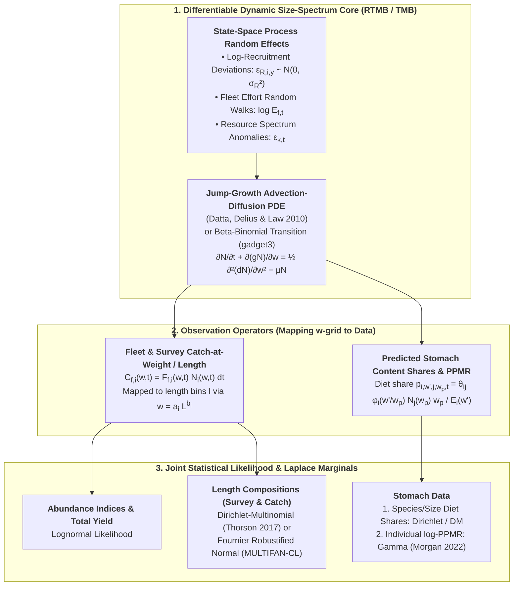

# Statistical Estimation, Data Weighting, Uncertainty Quantification, and an Architectural Roadmap for Dynamic `mizer` Stock Assessment {#sec-synthesis}

## Master Comparative Synthesis Across Multispecies Stock Assessment Model Families

A comprehensive architectural comparison across the eight multispecies stock assessment model families is presented in @tbl-master-synthesis:

| Feature / Dimension | `MSVPA` / `MSFOR` | `SMS` / `smsR` | `MSCAA` / `Hydra` | `CEATTLE` / `Rceattle` | `Gadget2` / `gadget3` | `LeMans` / `LeMaRns` | `EwE` / `Rpath` / `EcoState` | `mizer` (Standard & Jump-Growth) |
| :--- | :--- | :--- | :--- | :--- | :--- | :--- | :--- | :--- |
| **State Space** | Discrete Age $(s, a, y, q)$ | Discrete Age $(s, a, y, q)$ (+ ALK for stomachs) | Discrete Age $(s, a, y)$ (+ size bins in `Hydra`) | Discrete Age $(s, a, y)$ (sex-structured) | Joint Age-Length $(s, a, l, r, t)$ + Cell Mean Weight $W_{s,a,l,r,t}$ | Discrete Length $(s, l, t)$ (no age tracking) | Biomass Pools $B_i(t)$ + Multi-Stanza Age Groups | Continuous Body Mass Density $N_i(w, t)$ |
| **Governing Equations** | Backward VPA difference eqs. | Forward seasonal exponential survival | Forward SCAA difference eqs. | Forward SCAA difference eqs. | Sequential matrix operators (Migration, Predation, Beta-Binomial Growth) | Matrix projection with fractional bin growth $\phi_{i,j}$ | Coupled Foraging Arena ODEs | McKendrick–von Foerster PDE (or Jump-Growth Fokker–Planck PDE) |
| **Trophic Feedback** | **One-Way** ($M2$ only; fixed $w_{a,t}$ and ration $R_{a,q}$) | **One-Way** ($M2$ only; fixed $w_{a,t}$ and evacuation ration $R_{a,q}$) | **One-Way** ($M2$ only; fixed $w_{a,t}$) | **One-Way** or **Bioenergetic** ($T$-dependent ration & $w_{a,t}$) | **Two-Way** ($M2$ + consumption-driven $\Delta L_l, \Delta W_l$) | **One-Way** ($M2$ only; fixed von Bertalanffy growth) | **Two-Way** (Prey $M2$ $\leftrightarrow$ Predator production $g_i \sum_j Q_{ji}$) | **Full Two-Way** (Encounter $\to f_i(w) \to g_i(w), R_{p,i}, \mu_{s,i} \leftrightarrow \mu_{p,j}(w_p)$) |
| **Predation Functional Response** | Holling Type II (fixed total ration) | Holling Type II (fixed total ration) | Holling Type I, II, III, or Predator Interference | Holling Type II/III + Wisconsin Bioenergetics $f(T)$ | Holling Type II or III (`g3a_predate_catchability_predator`) | Holling Type II or III | **Foraging Arena** $Q_{ij} = \frac{a_{ij} v_{ij} B_i B_j}{2 v_{ij} + a_{ij} B_j}$ | Holling Type II (or Type III) with search rate $\gamma_i w^q$ |
| **Somatic Growth Dispersion** | None (empirical $w_{a,y,q}$) | None (empirical $w_{a,y,q}$ + ALK) | None (empirical $w_{a,y}$) | Empirical or bioenergetic $w_{a,y}$ | **Beta-Binomial** jump distribution (`g3a_grow_impl_bbinom`) | Deterministic upwind fraction $\phi_{i,j}$ | Multi-stanza von Bertalanffy | Upwind numerical diffusion (Standard) or **Jump-Growth PDE** $d_i(w)$ |
| **Stomach / Diet Likelihood** | Exact empirical iterative matching | **Dirichlet** (with $V_U = \theta / N_{\text{haul}}$) or Multinomial | Multinomial, Dirichlet, or Lognormal | Multinomial or Dirichlet | Weighted Sum of Squares or Multinomial on length-prey ratios | History Matching / SMC implausibility | Fixed Ecopath $DC_{ij,0}$ (`EwE`) or **Dirichlet** (`EcoState`) | Steady-state calibration or **Gamma/Normal log-PPMR** [@morgan2022] |
| **Catch & Survey Likelihoods** | Exact catch (no error) | Lognormal $C_{s,a,y,q}$ & Lognormal CPUE $I_{f,s,a,y}$ | Lognormal total catch/index + Multinomial age comps | Lognormal catch/index + Multinomial/DM age/length comps | Weighted composite likelihoods (`g3l_distribution_*`) | History Matching + SMC against survey biomass | SSQ (`Ecosim`) or Lognormal state-space (`EcoState`) | Steady-state yield/biomass SSQ or GA/MCMC [@zhang2015] |
| **Software / AD Engine** | Fortran / R | **ADMB** (`SMS`) & **TMB** (`smsR`) | **ADMB** / **TMB** | **TMB** (`Rceattle`) | C++ (`Gadget2`) & **TMB/R** (`gadget3`) | R / Rcpp (`LeMaRns`) | C#/.NET (`EwE`), R (`Rpath`), **TMB** (`EcoState`) | R / Rcpp (`mizer`) |
| **Key Reference** | [@helgason_gislason1979; @livingston1983] | [@lewy2004] | [@kinzey2009; @vankirk2010; @curti2013; @trijoulet2019] | [@holsman2016; @adams2022] | [@stefansson1998; @begley2004overview; @kulatska2019] | [@spence2020] | [@walters1997; @thorson2024] | [@scott2014; @pennino2025] |

: Comprehensive Comparative Synthesis of Multispecies Stock Assessment Model Frameworks {#tbl-master-synthesis}

---

## Data Weighting and Likelihood Conflict in Integrated & Multispecies Assessments (Francis 2011; Maunder & Punt 2013; Thorson et al. 2017)

When fitting an integrated single-species or multispecies model simultaneously to **abundance indices** ($I_{f,y}$), **catch biomass** ($Y_{f,y}$), **length/age compositions** ($\mathbf{P}_{f,y}$), and **stomach content compositions** ($\mathbf{W}_{A,L,y,q}$), the most critical statistical hazard is **likelihood conflict and compositional domination** [@francis2011; @maunder2013; @thorson2017].

### Why Unadjusted Composition Likelihoods Destroy Abundance Fits ("Francis Principle 1")
Suppose a survey measures $10,000$ fish lengths across $50$ length bins each year, while also providing $1$ annual biomass index point $I_y$ per year. If the nominal number of fish measured ($N_y = 10,000$) is plugged into a Multinomial likelihood $\sum_y N_y \sum_l P_{l,y} \ln \hat{P}_{l,y}$, the composition likelihood will have $1000\times$ larger gradient and curvature than the lognormal survey index likelihood $\frac{1}{2\sigma_I^2}(\ln I_y - \ln \hat{I}_y)^2$.

::: {.callout-important title="Francis's First Principle of Data Weighting"}
Because fish school by size and models have minor selectivity misspecifications, positive correlations among bins within a year mean the true **effective sample size** $N_{\text{eff}, y}$ is typically $20\text{--}200$ (closer to the number of **trawl hauls**, not individual fish!). If nominal sample size $N_y \sim 10,000$ is not downweighted, the optimizer will distort recruitment $R_y$, fishing mortality $F_y$, and biomass trends $\hat{B}_y$ just to chase noise in length compositions, violating **Francis's First Principle** [@francis2011, p. 1125]:

> *"Do not let other data stop the model from fitting abundance data well."*
:::

### Three Standard Data-Weighting Algorithms for Compositional Data

Let $O_{l,y}$ and $E_{l,y}$ denote the observed and model-expected proportions in length (or age) bin $l \in \{1, \dots, n_L\}$ with midpoint $x_l$ in year $y \in \{1, \dots, n_Y\}$, with initial nominal sample size $N_{y}$.

1. **McAllister & Ianelli (1997) Harmonic Mean Weighting**:
   Estimates the effective sample size $\hat{N}_{y} = \frac{\sum_{l} E_{l,y}(1 - E_{l,y})}{\sum_{l} (O_{l,y} - E_{l,y})^2}$ for each year and sets the dataset multiplier $w_{\text{MI}}$ using the harmonic mean across years (used in `MSCAA` [@curti2013] and `Rceattle` [@adams2022]; see [@mcallister_ianelli1997]).
   - *Critique [@francis2011, pp. 1128--1131]*: Assumes residuals across bins $l$ within the same year $y$ are uncorrelated. When residuals are positively correlated across adjacent length bins (the norm when growth or selectivity varies), McAllister–Ianelli **dramatically overweights** the composition data!

2. **Francis (2011) Method `TA1.8` (Mean-Length / Mean-Age Residual Variance)**:
   Collapses each year's length composition into its **observed mean length** $\bar{O}_y = \sum_l x_l O_{l,y}$ and **expected mean length** $\bar{E}_y = \sum_l x_l E_{l,y}$, with multinomial within-year variance $v_y = \sum_l x_l^2 E_{l,y} - \bar{E}_y^2$. Because collapsing to the annual mean $\bar{O}_y$ absorbs all within-year inter-bin correlations, the standardized mean-length residuals $\frac{\bar{O}_y - \bar{E}_y}{\sqrt{v_y / (w N_y)}}$ must have unit variance, yielding the **Francis `TA1.8` weight multiplier** [@francis2011, Appendix A, Table A1]:

   $$w_{\text{Francis}} = \left[ \text{Var}_{y}\!\left( \frac{\bar{O}_y - \bar{E}_y}{\sqrt{v_y / N_y}} \right) \right]^{-1}$$ {#eq-francis-weighting-ta18}

3. **Self-Weighting Likelihoods (Dirichlet-Multinomial / Logistic-Normal / SMS Dirichlet)**:
   Rather than outer fixed-point reweighting loops (`Francis TA1.8` or `Gadget` two-stage reweighting), modern TMB and SS3 models (`SMS`, `EcoState`, `LIME` [@rudd2018], `SS3` [@thorson2017]) use a **Dirichlet** or **Dirichlet-Multinomial** likelihood with an estimable dispersion parameter $\theta$, where effective sample size is either linear in $N_y$:
   $$N_{\text{eff}, y} = \frac{1 + \theta N_y}{1 + \theta}$$ {#eq-francis-dm-linear-neff}
   or saturating at $1 + \beta$:
   $$N_{\text{eff}, y} = \frac{N_y + N_y \beta}{N_y + \beta}$$ {#eq-francis-dm-saturating-neff}
   In a 4,500-replicate simulation study and Pacific hake application, [@thorson2017] proved that simultaneous DM estimation eliminates the severe bias of unweighted multinomial likelihoods, matches the accuracy and precision of iterative McAllister–Ianelli tuning for $M$, $\ln R_0$, and spawning output, and propagates data-weighting uncertainty directly into the joint Hessian and MCMC posterior!

---

## Parameter Estimation and Uncertainty Quantification Engines

### Frequentist / Empirical Bayes State-Space Estimation in `TMB` (Kristensen et al. 2016)
Modern statistical stock assessment models (`SAM` [@nielsen2014], `smsR`, `Rceattle`, `gadget3`, `EcoState` [@thorson2024]) are built on **Template Model Builder (`TMB`)** [@kristensen2016] or its pure-R interface **`RTMB`**.

Let $\boldsymbol{\theta} \in \mathbb{R}^p$ denote the vector of **fixed effects** (life-history scaling parameters, selectivities, catchabilities, suitability parameters $\beta_i, \sigma_i$, and variance parameters $\sigma_{\text{proc}}, \sigma_{\text{obs}}$) and let $\mathbf{u} \in \mathbb{R}^m$ denote the vector of **latent random effects (process errors)** (e.g., annual recruitment deviations $\epsilon_{R,i,y}$, time-varying fishing mortality random walks $\ln F_{f,y}$, or biomass process errors $\epsilon_{B,i,y}$). Given joint negative log-likelihood $f(\boldsymbol{\theta}, \mathbf{u}) = -\ln p(\mathbf{y}, \mathbf{u} \mid \boldsymbol{\theta})$, TMB approximates the marginal likelihood $L(\boldsymbol{\theta}) = \int \exp(-f(\boldsymbol{\theta}, \mathbf{u})) \, d\mathbf{u}$ via the **Laplace Approximation** [@kristensen2016, Eq. 2]:

$$-\ln L^{*}(\boldsymbol{\theta}) = f\!\left(\boldsymbol{\theta}, \hat{\mathbf{u}}(\boldsymbol{\theta})\right) + \frac{1}{2} \ln \det \mathbf{H}(\boldsymbol{\theta}) - \frac{m}{2} \ln(2\pi)$$ {#eq-penalized-loglik-priors}

where:
- $\hat{\mathbf{u}}(\boldsymbol{\theta}) = \arg\min_{\mathbf{u}} f(\boldsymbol{\theta}, \mathbf{u})$ is the inner-loop empirical Bayes mode of the random effects, and
- $\mathbf{H}(\boldsymbol{\theta}) = \left.\frac{\partial^2 f(\boldsymbol{\theta}, \mathbf{u})}{\partial \mathbf{u} \partial \mathbf{u}^\top}\right|_{\mathbf{u} = \hat{\mathbf{u}}(\boldsymbol{\theta})}$ is the sparse $m \times m$ Hessian matrix of the random effects, factored via sparse Cholesky decomposition (`CHOLMOD`).

Using up to third-order automatic differentiation (`CppAD`), TMB computes the exact gradient $\nabla_{\boldsymbol{\theta}} (-\ln L^{*}(\boldsymbol{\theta}))$ of the Laplace-approximated marginal likelihood in $O(1)$ reverse-mode sweeps, allowing `nlminb` or `optim` to estimate hundreds of fixed effects and thousands of random effects in seconds to minutes, followed by joint precision matrix inversion (`sdreport`) for derived quantities ($\text{SSB}_{i,y}, M2_{i,a,y}, F_{\text{MSY}, i}$).

---

### Bayesian, Evolutionary, and Ensemble Approaches (Zhang et al. 2015, 2016; Spence et al. 2016, 2018, 2021)
When models are implemented as black-box simulation packages without automatic differentiation (or when likelihood surfaces are rugged and multimodal), researchers have developed four complementary calibration and uncertainty frameworks for `mizer` and `LeMaRns`:

#### Two-Step Genetic Algorithm + Parallel Tempering MCMC (Zhang et al. 2015, 2016)

::: {.callout-tip title="Global Optimization Strategy for mizer Spin-Up"}
In calibrating a multispecies `mizer` model to data-poor and data-rich ecosystems [@zhang2015; @zhang2016], Zhang et al. found that standard gradient descent or single-chain Metropolis–Hastings gets trapped in local modes where one or more species go extinct during spin-up. They introduced a two-stage global optimizer:

- *Stage 1*: A parallel **Real-Coded Genetic Algorithm (GA)** searches the high-dimensional parameter space $(\ln R_{\max, i}, \kappa, q_{f,i}, F_i)$ using a survival penalty for extinct species to locate the global basin of attraction.
- *Stage 2*: **Parallel Tempering MCMC** (running multiple interacting Markov chains at temperatures $T_1 = 1 < T_2 < \dots < T_M$) samples the posterior distribution across multimodal ridges.
:::

#### History Matching + Sequential Monte Carlo (Spence et al. 2016, 2021)
To calibrate `mizer` [@spence2016] and `LeMaRns` [@spence2021uncertainty] to North Sea time series while explicitly accounting for **structural model discrepancy** $\boldsymbol{\eta}_{\text{disc}}$ (the difference between the true ocean and the best possible parameterization of the model), Spence et al. combined:

- **History Matching**: Defines an **implausibility measure** $I_k(\boldsymbol{\theta})$ for summary statistic $k$:
  $$I_k(\boldsymbol{\theta}) = \frac{\left|y^{\text{obs}}_k - \mathbb{E}[f_k(\boldsymbol{\theta})]\right|}{\sqrt{\text{Var}(y^{\text{obs}}_k) + \text{Var}(f_k(\boldsymbol{\theta})) + \text{Var}(\eta_{\text{disc}, k})}}$$ {#eq-abc-distance-metric}
  and rules out any parameter vector $\boldsymbol{\theta}$ where $\max_k I_k(\boldsymbol{\theta}) > 3$ (by Pukelsheim's $3\sigma$ rule), rapidly shrinking the feasible space before running full time-series likelihood evaluations.
- **Sequential Monte Carlo (SMC)**: Propagates a particle cloud $\left\{\boldsymbol{\theta}^{(p)}\right\}_{p=1}^P$ through sequential annealing or time-series filtering steps using Normalizing Flows / Metropolis-Hastings rejuvenation moves.

#### Bayesian Multi-Model Ensembles (Spence et al. 2018)
Instead of selecting a single "winner" model via AIC, [@spence2018] constructed a hierarchical Bayesian ensemble linking five distinct multispecies simulators (`EcoPath with Ecosim`, `LeMans`, `mizer`, `SMS`, and single-species assessments) as biased noisy realizations around a latent **true ecosystem trajectory** $\boldsymbol{\mu}_t$, decomposing structural discrepancy into shared vs. simulator-specific discrepancy processes.

---

## Architectural Blueprint for Next-Generation Statistical Dynamic Stock Assessment in `mizer`

In their 10-year review of `mizer`, [@pennino2025, Section *"Challenges and Future Directions"*, p. 9] identify the central barrier preventing `mizer` from being used as a routine tactical stock assessment tool:
> *"First, there is a lack of a standardized optimization routine for parameter estimation and uncertainty quantification... Second, `mizer` models are typically calibrated to a time-averaged steady state rather than fitted dynamically to time series of catches, survey indices, and size compositions."*

Drawing together the mathematical lessons from **`SMS`** (@sec-age-structured), **`Gadget`/`gadget3`**, **`MULTIFAN-CL`/`SS3`**, and [@punt2016] (@sec-length-structured), **`EcoState`** (@sec-size-spectrum), and **stomach content likelihoods** (@sec-stomach-data), we can synthesize a concrete, five-pillar architectural roadmap for transforming `mizer` into a **differentiable, state-space statistical multispecies stock assessment model** (`mizer-TMB` / `mizer-RTMB`).

---

### Pillar 1: Resolving Cohort Dispersion via Jump-Growth Diffusion (Datta, Delius & Law 2010)
When `mizer` is projected dynamically with interannual recruitment fluctuations $R_{\text{dd}, i}(t) \exp(\epsilon_{R,i,y})$, a strong year class enters at $w_0$ and propagates across the weight grid.
- **Problem**: Under the standard first-order upwind scheme, cohort width is governed by numerical grid viscosity $D_{\text{num}} \approx \frac{1}{2} g_i \Delta w$, which fails to match the true biological variance of size-at-age in survey length-frequency distributions.
- **Solution**: Replace the first-order upwind step with the **semi-implicit Crank–Nicolson / Chang–Cooper finite-volume discretization of the Jump-Growth Fokker–Planck PDE** [@datta2010, Eq. 7]:

  $$\frac{\partial N_i}{\partial t} + \frac{\partial (g_i N_i)}{\partial w} - \frac{1}{2} \frac{\partial^2 \left(\psi_{\text{disp}, i} \, d_i(w,t) \, N_i\right)}{\partial w^2} = -\mu_i(w,t) N_i$$ {#eq-mizer-tmb-jump-growth-pde}

  where $d_i(w,t)$ is the mechanistic second moment of prey mass intake, optionally scaled by a species-specific dispersion multiplier $\psi_{\text{disp}, i} \ge 1$ (analogous to Gadget's Beta-Binomial dispersion parameter $\beta_s$ in `g3a_grow_impl_bbinom`; [@lentz_gadget3]) to account for genetic growth variation and patchy foraging.
- **Computational Cost**: Discretizing the second derivative $\partial_w^2 (d_i N_i)$ changes the implicit linear system per species per time step from **lower-bidiagonal** to **tridiagonal**, which is still solved in exact **$O(n_w)$ operations** via the Thomas algorithm (`solve_tridiag`) and is $100\%$ differentiable in `TMB` / `RTMB`!

---

### Pillar 2: Two-Stage Initialization (Differentiable Steady-State Spin-Up + Dynamic Projection)
In single-species assessments (`SS3`, `SAM`), the initial age vector $N_{i,a,t_0}$ at the start of the historical time series $t_0$ is initialized at a fished equilibrium $N_{\text{eq}}(F_{\text{init}, i})$ plus initial deviations.
For dynamic `mizer`:
1. **Differentiable Steady-State Initialization at $t = t_0$**:
   Given trial parameters $\boldsymbol{\theta}$ and baseline initial fishing effort $E_{f, t_0}$, compute the steady-state spectra $N_{i,0}(w)$ via a fixed number ($k = 15\text{--}25$) of damped fixed-point iterations of the analytical steady-state envelope $N_i(w) = N_i(w_0)\frac{g_i(w_0)}{g_i(w)}\exp\!\left(-\int_{w_0}^w \frac{\mu_i(w')}{g_i(w')} dw'\right)$ (with matching resource $N_{R,0}(w)$). Because a fixed number of unrolled iterations uses only elementary vector operations, `TMB` / `RTMB` differentiates smoothly through the steady-state initialization!
2. **Dynamic Time-Stepping ($t \in [t_0, T]$)**:
   Step forward in quarterly or monthly increments $\Delta t$ (e.g., $\Delta t = 0.1$ or $0.25\text{ yr}$) driven by time-varying fishing mortality $F_{f,i}(w, t)$, temperature anomalies $T(t)$ (scaling metabolic rates $k_{s,i}$, intake $h_i$, and search rates $\gamma_i$ via Arrhenius activation $e^{-E_a / k_B T}$), and state-space recruitment deviations $\epsilon_{R,i,y}$.

---

### Pillar 3: State-Space Process Random Effects ($\mathbf{u}$)
Following `SAM` [@nielsen2014] and `EcoState` [@thorson2024], introduce three compact sets of latent Gaussian random effects integrated out by TMB's Laplace approximation:
1. **Annual Recruitment Deviations**:
   $$R_i(t) = R_{\text{dd}, i}(t) \exp\!\left(\epsilon_{R, i, y(t)} - \frac{1}{2}\sigma_{R, i}^2\right), \qquad \epsilon_{R, i, y} \sim \mathcal{N}\!\left(0, \sigma_{R, i}^2\right)$$ {#eq-mizer-recruitment-anomaly}
2. **Resource Spectrum Productivity / Carrying Capacity Anomalies** (capturing bottom-up climate/plankton regimes):
   $$\kappa_R(w, t) = \kappa_0 \exp\!\left(\epsilon_{\kappa, y(t)}\right) w^{-\lambda}, \qquad \epsilon_{\kappa, y} \sim \text{AR1}\!\left(\rho_\kappa, \sigma_\kappa^2\right)$$ {#eq-mizer-carrying-capacity-anomaly}
3. **Random-Walk Fishing Effort / Mortality** (when commercial effort is noisy or unrecorded):
   $$\ln E_{f, y+1} \sim \mathcal{N}\!\left(\ln E_{f, y},\; \sigma_{E, f}^2\right)$$ {#eq-mizer-fishing-effort-random-walk}

---

### Pillar 4: Observation Operators and Joint Statistical Likelihood Function
To avoid the parameter confounding identified by [@punt2016], dynamic `mizer` should be fitted simultaneously to four orthogonal empirical data streams:

1. **Survey Biomass / Abundance Indices ($I_{f,i,y}$, Lognormal Likelihood)**:
   Given survey selectivity $S^{\text{surv}}_{f,i}(w)$ and catchability $Q^{\text{surv}}_{f,i}$:
   $$\hat{I}_{f,i,y} = Q^{\text{surv}}_{f,i} \int_{w_0}^{w_{\max,i}} S^{\text{surv}}_{f,i}(w) \, w \, N_i(w, t_y) \, dw, \qquad \ln I^{\text{obs}}_{f,i,y} \sim \mathcal{N}\!\left(\ln \hat{I}_{f,i,y},\; \sigma^2_{I,f,i,y}\right)$$ {#eq-mizer-survey-biomass-operator}

2. **Commercial Fishery Yields ($Y_{f,i,y}$, Lognormal Likelihood)**:
   $$\hat{Y}_{f,i,y} = \int_{y}^{y+1} dt \int_{w_0}^{w_{\max,i}} F_{f,i}(w, t) \, w \, N_i(w, t) \, dw, \qquad \ln Y^{\text{obs}}_{f,i,y} \sim \mathcal{N}\!\left(\ln \hat{Y}_{f,i,y},\; \sigma^2_{Y,f,i}\right)$$ {#eq-mizer-yield-operator}

3. **Survey & Commercial Length-Frequency Compositions ($\mathbf{P}^{\text{obs}}_{f,i,y}$, Dirichlet-Multinomial or Fournier Robustified Normal Likelihood)**:
   For observed length bin $l$ with boundaries $[L_l, L_{l+1})$ corresponding to body weights $[w_{i,l}, w_{i,l+1}) = [a_i L_l^{b_i}, a_i L_{l+1}^{b_i})$, the expected catch number in bin $l$ is:
   $$\hat{C}_{f,i,l,y} = \int_{w_{i,l}}^{w_{i,l+1}} S_{f,i}(w) \, N_i(w, t_y) \, dw, \qquad \hat{p}_{f,i,l,y} = \frac{\hat{C}_{f,i,l,y}}{\sum_{m} \hat{C}_{f,i,m,y}}$$ {#eq-mizer-length-composition-operator}
   Evaluated via the **self-weighting Dirichlet-Multinomial likelihood** [@thorson2017] with haul sample size $N_{\text{haul}, f, y}$ and estimated overdispersion $\theta_{\text{comp}, f, i}$ (or Fournier's robustified normal likelihood from `MULTIFAN-CL` [@fournier1998] to prevent tail outliers from distorting growth parameters).

4. **Stomach Content Diet Shares & Log-PPMR Distributions (Dirichlet-Multinomial + Gamma Likelihood)**:
   For predator $(i, w')$ in year-quarter $t$, the model-predicted mass share of prey species $j$ in prey weight bin $[w_{p,m}, w_{p,m+1})$ in the diet is:
   $$\hat{W}_{i,w', j, m, t} = \frac{\gamma_i(w') \, \theta_{ij} \int_{w_{p,m}}^{w_{p,m+1}} \phi_i(w' / w_p) \, N_j(w_p, t) \, w_p \, dw_p}{E_i(w', t)}$$ {#eq-mizer-stomach-diet-operator}
   - **Taxonomic Diet Shares**: Fit evacuated, CPUE-weighted (or `sdmTMB`-standardized; [@jacobsen2023]) stomach weight proportions against $\hat{W}_{i,w',j,m,t}$ using the **SMS Dirichlet** [@lewy2004] or **Dirichlet-Multinomial** [@thorson2017] likelihood, which directly identifies the interaction matrix $\theta_{ij}$!
   - **Predator–Prey Size Kernel Parameters ($\beta_i, \sigma_i$ or Gamma $\alpha_i, \beta_i$)**: Fit the observed log-PPMR distribution $x = \ln(w'/w_p)$ using the **Exponential Family / Gamma likelihood** of [@morgan2022].

---

### Pillar 5: Stabilizing Dynamic Multi-Decadal Fits via Prey Refuges & Overconsumption Caps
A major lesson from `Gadget` [@lentz_gadget3], `MSCAA` [@curti2013], and `Ecosim`/`EcoState` [@walters1997; @thorson2024] is that during gradient optimization over a 40-year time series, trial parameter values can easily trigger runaway trophic cascades unless two stabilizing mechanisms are included:
1. **Holling Type III Exponent or Foraging Arena Vulnerability**: Replacing linear encounter $\theta_{ij} N_j(w_p)$ with a weakly sigmoid Type III encounter $\theta_{ij} N_j(w_p)^{1 + \zeta}$ ($\zeta \approx 0.1\text{--}0.3$) or a Foraging Arena predator-interference denominator $\frac{\theta_{ij} v_{ij}}{2 v_{ij} + \gamma_i N_i}$ provides a low-density prey refuge and prevents unrealistic species extinctions during parameter search.
2. **Smooth Differentiable Overconsumption Cap (`dif_pmin`)**: Borrowing `gadget3`'s smooth logistic minimum cap on total mortality per time step ensures that $N_i(w, t)$ remains strictly positive and gradients $\nabla_{\boldsymbol{\theta}} \mathcal{L}$ remain finite across the entire parameter space.
